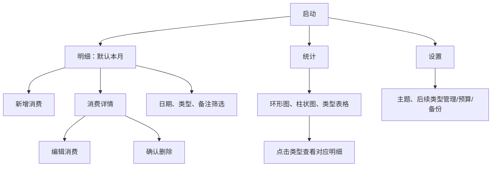

# 简记 Android 记账 App 开发文档

版本：v0.2 · 日期：2026-10-23 · 状态：开发前设计

本文定义产品范围与业务规则；[详细设计](详细设计.md)进一步定义功能类、方法签名、状态机、接口调用、数据库事务和处理流程。两份文档共同作为编码与验收依据。P0 已编码，实际类映射、验证结果和未实现的 P1 范围见[实现与验证记录](实现与验证记录.md)。

本次 v0.2 补充：新增请求幂等记录、消费修订号、数据集标识及变更序号，用于处理重复提交、过期编辑和后续备份恢复；具体结构与调用协议见详细设计第 3～6 节。

1.2.0 实现更新：已支持全部账单 JSON 导入/导出和 CSV 导出。采用预览后的合并导入，不执行本文早期规划的全量替换；文件上限为 10 MiB、10,000 笔账单、200 个类型。当前范围、字段契约及验证见[1.2.0 更新说明](更新说明-1.2.0.md)。

## 1. 产品目标与默认假设

帮助个人快速记录日常消费，随时查找历史账单，并通过消费类型的图表了解支出结构。首版以“打开即可记账、离线可用、金额准确”为目标。

本方案默认：简体中文、人民币 CNY、单用户、单账本、只记支出、Android 8.0 及以上、手机竖屏优先且支持旋转。无需注册，无服务端，不收集消费内容。收入、账户转账、多币种及多人共享不进入首版，避免不同账务口径混合。文中的功能为规划，具体已完成项见环境验证记录。

## 2. 功能范围与优先级

| 优先级 | 功能 | 说明 |
|---|---|---|
| P0 | 添加消费 | 金额、消费类型、消费日期、可选备注；保存成功后反馈 |
| P0 | 修改消费 | 从明细进入编辑，保留原始创建时间，更新修改时间 |
| P0 | 删除消费 | 二次确认后删除，明细、汇总和图表同步刷新 |
| P0 | 历史消费 | 日期倒序、按天分组、分页、按日期/类型/备注筛选 |
| P0 | 消费统计 | 本月/上月/自定义范围，类型环形图、类型金额柱状图和文字表格 |
| P0 | 类型选择 | 内置餐饮、交通、购物、居住、娱乐、医疗、教育、其他 |
| P0 | 本地持久化 | Room 数据库；进程退出及重启后数据保留 |
| P0 | 基础体验 | 输入校验、空态/错误态、深浅主题、无障碍、保存防重复 |
| P1 | 自定义类型 | 新建、改名、排序、停用；有历史记录的类型不可直接删除 |
| P1 | 月度预算 | 设置当月总预算、已花/剩余/超支状态；不发送通知 |
| P1 | 数据备份 | 手动 JSON 导出/恢复，CSV 导出；通过系统文件选择器操作 |
| P1 | 删除撤销 | 短时撤销交互；数据库提交和撤销一致性验证后启用 |
| P2 | 扩展方向 | 收入/多账本、周期记账、账单导入、生物识别锁、加密与同步 |

P0 是首版验收范围。预算与备份提高长期可用性，但不得挤占 P0 数据正确性的验证。

## 3. 信息架构与页面交互

底部导航为“明细 / 统计 / 设置”。明细页使用明显的“记一笔”主按钮。



### 3.1 明细和历史查询

- 顶部展示当前范围和支出合计，默认当月，可快速切换月份及自定义日期。
- 按消费日期倒序分组；组内按创建时间倒序，同时间以 ID 稳定排序。每条展示类型图标/名称、金额和备注摘要；每天展示小计。
- 类型支持多选；备注关键词按字面匹配，不将 `%`、`_` 解释为 SQL 通配符；多条件取交集。清除筛选恢复当月。
- 采用 Paging 3，每页 30 条；日期、类别查询走索引。全账本历史可通过日期范围入口访问。
- 没有记录时显示“还没有消费记录，记下第一笔吧”；筛选无结果时显示“当前条件无记录”及清除入口。
- 点击条目进入详情，提供编辑和删除。删除确认框展示金额、类型、日期，避免误删；取消不改变数据。

### 3.2 添加和修改

字段顺序为金额 → 类型 → 日期 → 备注。金额使用十进制键盘；类型使用图标加文字网格，默认未选中，用户明确选择后才可保存；日期默认今天，不允许未来日期。首版只保存消费日期，不让用户维护消费时分秒。

| 字段 | 规则 | 错误反馈 |
|---|---|---|
| 金额 | 0.01～999,999.99 元；最多两位小数；不允许负数、零、指数写法 | 就地提示合法范围，不静默四舍五入 |
| 类型 | 必选有效类型 | 提示选择类型；编辑历史记录允许保留已停用类型 |
| 日期 | 1970-01-01 至设备当前本地日期 | 日期选择器限制范围；保存再次校验 |
| 备注 | 可空；去除首尾空白，最多 200 个 Unicode 码点 | 字数提示，超限不可保存 |

输入 `12`、`12.3`、`12.30` 均有效；只将全角数字 `０～９` 与全角小数点 `．` 转换为半角，中文数字（如“十二”）、千分位和逗号小数输入明确报错。保存期间禁用按钮；新增表单生成固定消费 UUID，每次提交另生成 operationId，相同请求重试复用 operationId，并通过事务内的幂等记录防止重复写入。写入完成才关闭页面，失败保留草稿并允许重试。使用 SavedStateHandle 保存草稿；有未保存修改时退出需确认。

编辑保存通过单次事务更新，以读取时的 revision 检测并发修改；版本不符时提示重新加载，不覆盖较新记录。如果目标已被删除，则告知记录不存在并返回明细。删除与修改都触发同一数据流刷新，避免用户手动刷新。

### 3.3 消费统计与图表

- 日期筛选默认当月，支持上月、全年及自定义区间；页面明确展示统计起止日期和币种。
- 顶部指标：总支出、记录笔数、日均支出。日均以**选定范围的自然日数**为分母；当前月份/年份的截止日截到今天。无记录日期也计入分母。
- 环形图展示类型占比，中心展示总额；图例显示类型名称、金额和百分比。类型颜色由稳定的颜色键映射，排序变化不改颜色。
- 柱状图按金额降序展示各类型总额，金额相同按类型排序号、ID 排序；使用水平柱形布局容纳中文名称，不使用 3D 图表。
- 自定义类型超过 8 个时，图形展示前 7 类加“其余类型”聚合；下方表格仍展示所有真实类别。“其余类型”不是数据库类别，不能与内置“其他”混淆；点击它打开剩余类别明细集合。
- 占比计算使用原始分值除以总分值，图形角度基于未舍入比例；显示保留一位小数，允许显示总和有 ±0.1% 等舍入差，界面给出说明。累计值不得用浮点数。
- 总额为 0 时不绘制扇区，不出现除零、NaN 或虚构占比，显示空态。单一类型绘制完整圆环。图表提供文本数据表与 TalkBack 描述，信息不只靠颜色表达。
- 点击真实类型后，明细复用相同日期范围和类型 ID；从明细返回仍保留统计筛选。编辑/删除记录后图表随数据库 Flow 自动更新。
- 首版使用 Compose Canvas 绘制简单环形图与水平柱形图；将统计结果与绘图组件解耦。金额标签使用原始整数金额格式化，只有绘图长度/角度转换为 Float。

### 3.4 设置与后续补充

主题默认跟随系统。类型管理采用停用而非级联删除；更名同步显示在历史记录中，统计始终按稳定 ID 分组。P1 预算按自然月与 CNY 保存，剩余额 = 预算 - 月支出，允许负数表示超支，预算未设时不显示虚假进度。

P1 备份采用带 schemaVersion、导出时间、币种与完整实体的 JSON；恢复前校验格式、范围、重复 ID、类型引用、记录数量上限，在单个数据库事务中全量替换，用户确认前展示影响并提供先导出入口，失败则回滚。CSV 只用于报表导出、不承诺无损恢复；按 RFC 4180 转义，并对文本公式前缀做防护。备份包含个人财务信息，导出时说明其为明文文件。

## 4. 数据模型和正确性约束

### 4.1 类型表 categories

| 字段 | 类型 | 说明 |
|---|---|---|
| id | TEXT 主键 | 稳定 UUID；内置类型使用固定 ID |
| name | TEXT | 类型名，去除首尾空白后 1～12 个码点 |
| normalizedName | TEXT，唯一索引 | NFKC 归一化、去除首尾空白、Locale.ROOT 小写转换后的名称键 |
| iconKey / colorKey | TEXT | 受控图标/颜色键，未知值回退至“其他”样式 |
| sortOrder | INTEGER | 展示次序 |
| isBuiltIn / isArchived | INTEGER | 内置标记/停用标记 |
| createdAt / updatedAt | INTEGER | UTC epoch 毫秒 |

类型名归一化后不可重复；所有类型（包括停用项）保留唯一名称。内置类型可排序、停用和启用，不允许改名、改图标或删除；自定义类型可改名。首次创建数据库时在事务中写入内置类型，使用固定 ID 保证幂等。

### 4.2 消费表 expenses

| 字段 | 类型 | 说明 |
|---|---|---|
| id | TEXT 主键 | 表单生命周期固定的 UUID |
| amountMinor | INTEGER / Kotlin Long | 人民币分，范围 1～99,999,999 |
| currencyCode | TEXT | 首版固定 CNY |
| categoryId | TEXT 外键 | categories.id，ON DELETE RESTRICT |
| spentOnEpochDay | INTEGER / Long | 消费日期的 LocalDate.toEpochDay() |
| note | TEXT | 默认空字符串 |
| createdAt / updatedAt | INTEGER / Long | UTC epoch 毫秒，用于排序和审计 |
| revision | INTEGER / Long | 从 1 开始；每次实际修改递增，编辑和删除需匹配预期版本 |

索引：`(spentOnEpochDay, createdAt, id)`、`(categoryId, spentOnEpochDay)`。金额、币种、日期等在 domain 层验证；数据库通过主键、外键、NOT NULL 保证结构约束，DAO 不暴露给 UI。使用 RESTRICT 防止删除类型时丢失历史消费。多币种扩展前必须新增独立汇率和统计规则，不能直接对不同币种求和。

金额解析使用 BigDecimal 精确校验小数位后转成 Long 分值；数据库 SUM(amountMinor) 使用 Long，显示阶段再格式化为元，不使用 Double 保存金额。所有范围遵循 `[startEpochDay, endEpochDayExclusive)`；用户选定的结束日通过 plusDays(1) 转换为开区间上界。

消费日期是用户录入的业务日期，不因时区改变而迁移；createdAt/updatedAt 是实际 UTC 时间。默认“今天”通过可注入 Clock 与设备 ZoneId 计算，便于测试。跨月、跨年、闰日使用 java.time 处理，minSdk 26 原生支持。

### 4.3 统计查询

```sql
SELECT c.id, c.name, c.colorKey, c.iconKey, c.sortOrder,
       SUM(e.amountMinor) AS totalMinor, COUNT(*) AS entryCount
FROM expenses e
JOIN categories c ON c.id = e.categoryId
WHERE e.spentOnEpochDay >= :startInclusive
  AND e.spentOnEpochDay < :endExclusive
  AND e.currencyCode = 'CNY'
GROUP BY c.id, c.name, c.colorKey, c.iconKey, c.sortOrder
ORDER BY totalMinor DESC, c.sortOrder ASC, c.id ASC;
```

由同一聚合结果计算总额与占比，确保总额等于各类型合计。历史页与统计页共享 DateRange 和 CategoryFilter，不重复定义日期边界。Room 使用 Flow 观察表变更；大查询在 IO 调度执行，不在主线程查询。数据库 schema JSON 纳入版本管理，后续升级必须写 Migration 和迁移测试，不使用 destructive migration 清空财务数据。

### 4.4 写入可靠性辅助表

P0 同时建立 `app_meta` 与 `mutation_receipts`：前者保存当前数据集标识 dataEpoch 和变更序号 changeSeq；后者保存成功命令的 operationId、规范化请求摘要和执行结果。消费变更、命令回执及 changeSeq 更新必须在同一个事务中提交。回执不保存消费备注等完整输入；相同命令重试返回原结果，不能再次插入或覆盖数据。表结构、保留策略及恢复处理见[详细设计](详细设计.md)第 3.3 节。

## 5. 技术方案

| 层次 | 方案 | 原因 |
|---|---|---|
| 平台 | Kotlin + Android 原生 | 贴合 Android 生命周期与系统能力 |
| UI | Jetpack Compose + Material 3 | 表单、主题、状态和绘图统一 |
| 状态 | ViewModel + StateFlow + 单向数据流 | UI 观察状态，操作通过事件进入业务层 |
| 数据 | Room + Coroutines + Flow | 离线持久化、事务、可观察查询 |
| 历史列表 | Paging 3 | 控制大量账单的内存和加载耗时 |
| 偏好 | DataStore Preferences | 保存主题等非账务设置 |
| 导航 | Navigation Compose | 明细、详情、编辑及筛选参数导航 |
| 依赖注入 | 首版手动 AppContainer | 控制初期复杂度，后续可迁移 Hilt |
| 图表 | Compose Canvas + 可访问文本表格 | 首版图形简单，避免图表库升级约束 |
| 测试 | JUnit、Room 仪器测试、Compose UI 测试 | 覆盖金额、持久化、迁移和核心流程 |

工程初期单 app module，按业务包划分；规模增长后才拆分 Gradle 模块。

```text
app/src/main/java/com/example/jianji/
  MainActivity.kt              # 当前骨架入口
  ui/JianjiApp.kt              # 当前骨架导航与状态说明
  ui/theme/                   # 以下为后续目标结构
  feature/expenses/            # 明细、详情、编辑、筛选
  feature/statistics/          # 统计与图表
  feature/settings/
  domain/model/               # Money、DateRange、Expense、Category
  domain/usecase/              # 校验、保存、删除、汇总
  domain/repository/           # 业务写入与单条观察接口
  application/query/          # Paging 查询接口和筛选结果契约
  data/local/                 # Room Entity、DAO、Database、Migration
  data/repository/
  di/AppContainer.kt
```

调用链为 Compose → ViewModel → UseCase / Repository → DAO → Room。数据库是账单的唯一事实来源，不单独维护一份可漂移的统计缓存。UI 状态区分 Loading、Content、Empty、Error；错误信息可读，调试日志不打印完整账单和备注。

依赖版本集中在 `gradle/libs.versions.toml`。当前骨架只启用 Compose 和必要 AndroidX 库；Room、KSP、Navigation、Paging、DataStore 在对应里程碑成套加入并验证，避免将未使用依赖误认为已实现功能。

## 6. 非功能与隐私要求

- 无联网业务，因此首版不声明 INTERNET，不请求通讯录、定位、短信、广泛存储权限。
- 数据保存在应用私有目录；系统自动备份默认关闭并通过提取规则排除数据库和设置，手动导出由用户发起。仍需验证不同 Android 版本及 OEM 迁移行为，应用私有存储不等同于自建数据库加密。
- 当前骨架未使用数据库。后续未实现手动备份前，卸载/清除数据会丢失本地记录，设置页需明确提示。
- 支持浅色/深色主题、系统返回、旋转、大字体与 TalkBack。触控目标至少 48dp，关键文本对比度至少 4.5:1；图表附文字数据。
- 性能验收目标：指定中端 Android 设备上冷启动可交互 ≤ 2 秒，1 万条记录下首页/单月统计 P95 ≤ 300ms；记录设备、release 构建与 30 次样本，不将桌面构建通过等同于性能达标。
- release 不使用 debug 签名；签名文件和密码不进仓库。上架前调整最终 applicationId、隐私说明、targetSdk 和商店资料。

## 7. 验收与测试计划

| 编号 | 场景 | 通过条件 |
|---|---|---|
| A01 | 新增餐饮 12.30 元 | 明细出现一条、存储 1230 分、月统计增加 1230 分；重启保留 |
| A02 | 修改金额、类型与月份 | 原分类/原月份扣除，新分类/新月份增加，无重复记录 |
| A03 | 删除及取消删除 | 取消不变；确认后明细和统计同时消失；重启不会复现 |
| A04 | 非法金额 | 空、0、负数、三位小数、超上限、指数格式全部拒绝 |
| A05 | 连续点击保存/失败重试 | 只生成一条记录，写入失败保留输入 |
| A06 | 历史筛选与分页 | 月边界、闰日、多选类型、中文和 `%_` 备注按规则匹配，无重复遗漏 |
| A07 | 图表正确性 | 餐饮 10 元、交通 30 元，合计 40 元，占比 25%/75%，柱状金额一致 |
| A08 | 空/单类/很多类型 | 空态不除零，单类 100%，超过 8 类聚合不漏金额，文本表完整 |
| A09 | 日期及日均 | 自定义 3 天支出 30 元显示 10 元/天；今天后日期不可选；改变时区不改历史日期 |
| A10 | 统计钻取 | 点击类别得到与图表相同区间和类型的明细，返回筛选保留 |
| A11 | 生命周期 | 旋转、后台恢复保留未保存草稿；重启后已保存记录存在 |
| A12 | 访问性与兼容性 | API 26、35 真机或模拟器；大字体、深色、TalkBack 不遮挡主要操作 |
| A13 | 数据升级 | 带旧账单的数据库迁移后金额、类型和日期不丢失 |
| A14 | P1 备份/类型/预算 | 备份往返一致、损坏恢复回滚、停用不丢记录、跨月预算正确 |

金额解析、日期区间、汇总和 Top-N 聚合做纯单元测试；外键/聚合 Flow/CRUD/迁移做 Room 仪器测试；新增→编辑→统计→删除做 Compose 端到端测试。每阶段至少执行 `assembleDebug`、`lintDebug` 与该阶段对应测试。无设备时只标记“待运行”，不能将未执行的仪器测试报为通过。

## 8. 开发里程碑与完成定义

以下估算按 1 名熟悉 Kotlin 的开发者计，不含商店审核，需按实际反馈调整。

| 阶段 | 预计工作日 | 产物与退出条件 |
|---|---|---|
| M0 规划与准备（本次） | 0.5～1 | 本文档、环境说明、工程骨架、debug APK 构建和 lint 结果 |
| M1 数据与记账 | 2～3 | Room、预置类型、金额校验、新增/编辑/删除；A01～A05、A13 |
| M2 历史与查询 | 1～2 | 分组分页、筛选、详情与草稿恢复；A06、A11 |
| M3 统计与图表 | 2～3 | 聚合、图表、空态、筛选联动；A07～A10 |
| M4 首版质量验证 | 1～2 | 设备测试、访问性、性能测量；P0 验收通过 |
| M5 可选增强 | 2～4 | 类型管理、预算、备份与恢复；A14 |

最小完整闭环为新增一笔 → 历史找到它 → 修改类型 → 图表更新 → 删除 → 汇总归零。M0 的工程入口只用于确认环境与界面框架；不代表 P0 功能完成。

## 9. 风险与后续决策

1. 财务数据丢失风险：禁用破坏性迁移，P1 优先做备份；正式长期使用前需有明确导出方案。
2. 金额和日期口径：全链路整数分值、日期开区间及可注入 Clock，避免浮点/时区边界错误。
3. 图表可读性：稳定颜色、长名称布局、文字表格及多类别聚合，避免只看图形无法理解数据。
4. 构建兼容性：采用固定的兼容工具链，不宣称其为最新版本；发布前核验依赖漏洞、SDK 和商店要求，再进行成套升级。
5. 最终品牌、包名、分发渠道与是否支持收入尚未确定；本次采用“简记”和 `com.example.jianji` 作为开发占位，不阻塞本地开发。

## 10. 详细设计阅读索引

详见[功能类、接口调用与执行流程设计](详细设计.md)：

| 开发任务 | 对应详细设计章节 |
|---|---|
| 确定类职责与依赖方向 | 第 2 节：分层与功能类 |
| 编写模型、状态与数据库 | 第 3 节：核心对象和持久化结构 |
| 实现 Repository / QueryService / DAO | 第 4 节：接口契约和调用矩阵 |
| 接入启动、导航、页面状态 | 第 5 节：启动与 UI 状态管理 |
| 实现新增、编辑、删除 | 第 6 节：写入事务、时序与失败处理 |
| 实现历史分页与分类统计 | 第 7～8 节：查询、聚合与图表算法 |
| 接入主题、类型、预算与备份 | 第 9 节：设置与 P1 扩展 |
| 编写异常分支与测试 | 第 10～11 节：错误协议、任务拆分与测试映射 |

