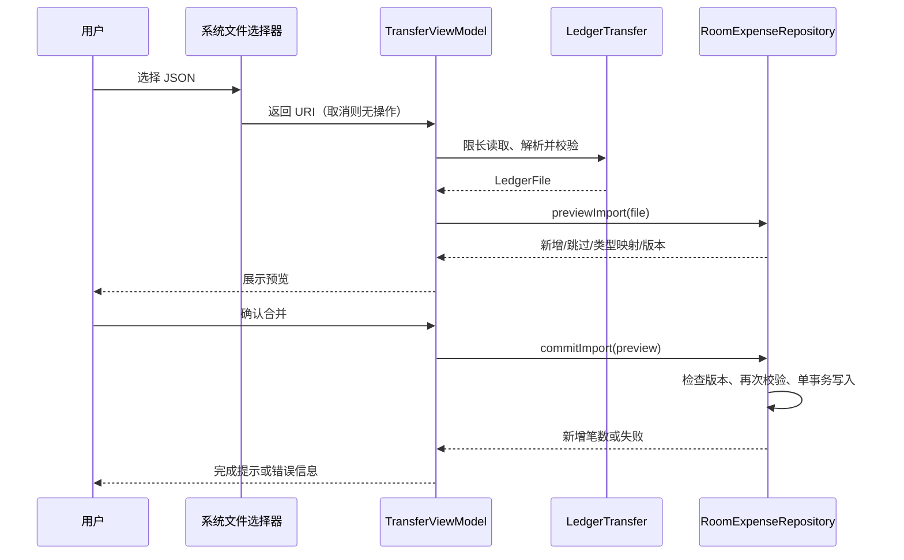

# 简记 1.2.0：账单导入与导出

日期：2026-10-27。versionCode 6，沿用原正式签名，数据库仍为 schema v1，无需迁移。

## 使用方法与范围

进入「设置 → 账单导入与导出」。

- **导出 JSON**：通过系统文件选择器保存全部历史账单和消费类型，包含停用类型、记录 ID、整数分金额、日期、备注和审计信息。文件可再次导入简记。
- **选择 JSON 导入**：读取简记账单文件，展示新增笔数、新增金额、重复笔数、类型数量和最多 5 笔示例，点击「确认合并导入」后写入。取消或返回不修改账本。
- **导出 CSV**：保存全部账单，UTF-8 BOM 编码、中文表头、金额单位为元，可用 Excel 打开。CSV 不支持导入；第三方账单文件不直接兼容本版。

文件为明文，请保存到可靠位置。单个文件同时受 10 MiB、10,000 笔账单、200 个类型限制；导入后的账本也不能超过该数量。超限会报错，不会截断导出或静默漏掉记录。导出范围为全部历史记录，不受当前明细筛选影响。主题、图表偏好和操作回执不包含在文件中。

## 合并规则

1. 类型优先按稳定 ID 匹配，其次按规范化名称匹配；不存在的类型自动创建。已有类型的名称、颜色、排序和停用状态均保留。导入历史账单可以关联停用类型，但普通新增账单仍不能选择停用类型。
2. 账单按 ID 去重。ID 相同且金额、映射后的类型、日期、备注相同，则跳过；仅修订号或审计时间不同也保留本机记录。
3. 同 ID 内容不同则整个文件拒绝导入，并提示文件中的账单序号，不覆盖已有内容。不同 ID 的相同金额/日期记录会分别保留，避免误删真实的重复消费。
4. 已从本机删除、但仍存在于文件的账单会重新导入；预览明确提示该行为。
5. 预览后若其他操作改变账本或类型，确认时拒绝过期预览，须重新选择文件。全部类型和账单在同一 Room 事务内提交，失败整体回滚。
6. 导入成功后重新选择相同文件，已导入的 ID 会被跳过。若应用在执行过程中被系统关闭，可重新选择文件，核对新的预览；未完成的事务由数据库回滚。

本版是「合并导入」，不会全量替换数据库。早期详细设计第 9.3～9.4 节中 `jianji-backup`、预算、50 MiB/100,000 笔上限、筛选 CSV 和全量恢复仍是后续设计，不属于本版契约。当前文件标识为 `jianji-ledger`，schemaVersion 为 1。

## 功能类与接口

| 类/方法 | 职责 |
|---|---|
| `LedgerTransfer.json / parse / csv` | JSON 编解码、严格字段校验、CSV 转义和公式前缀防护 |
| `LedgerFile` | 跨文件边界的类型和账单数据，不携带本机 epoch、sequence、回执 |
| `RoomExpenseRepository.exportLedger()` | 短读事务捕获一致快照；结束事务后再写外部文件 |
| `previewImport(file)` | 在事务内校验、类型映射、查重，生成带 epoch/sequence 的预览 |
| `commitImport(preview)` | 共享写锁下检查预览版本，再校验并原子写入；更新 changeSeq |
| `LedgerDocuments / AndroidLedgerDocuments` | ContentResolver URI 流读写；读取过程中累计检查大小，关闭流 |
| `TransferViewModel` | 空闲/处理中/预览/成功/失败状态，IO 调度，防止连续点击重复执行 |
| `TransferScreen / TransferContent` | 系统文件选择器、预览确认、取消、进度和结果展示 |

金额使用整数分；JSON 数字字段必须为整数，拒绝字符串数字、小数金额、溢出值。日期为从 1970-01-01 起的天数，不能为未来日期；备注最多 200 个 Unicode 字符。验证 UUID、类型引用、重复 ID、规范化重名、颜色、审计时间、修订号和币种。严格 JSON 读取拒绝重复字段、截断文件、额外尾部内容、无效 UTF-8 和超过 8 层的嵌套。

| JSON 对象 | 必需字段 |
|---|---|
| 根对象 | `format="jianji-ledger"`、`schemaVersion=1`、`currencyCode="CNY"`、`exportedAt`（非负毫秒时间戳）、`categories`、`expenses` |
| 消费类型 | `id`、`name`、`iconKey`、`colorKey`（ARGB 整数）、`sortOrder`、`archived`（布尔值） |
| 账单 | `id`、`amountMinor`（分）、`categoryId`、`spentOn`（epoch day）、`note`、`createdAt`、`updatedAt`（非负毫秒时间戳）、`revision` |

审计时间允许修改时间早于创建时间：用户调整设备时钟可能产生这种顺序，不应因此阻止真实账单导出。消费日期仍按设备当前日期校验。

文件选择使用 `OpenDocument`、`CreateDocument("application/json")`、`CreateDocument("text/csv")`，不新增存储或联网权限。用户选择的系统文档提供者可自行提供本地或云端存储。文件流与编解码在 IO 线程执行；不在等待外部文档提供者时持有数据库事务。预览保留在 ViewModel，支持屏幕旋转；进程退出后重新选择文件，不将整份账单写入 SavedStateHandle。

外部文档提供者不保证原子写文件。写入或关闭流失败时显示失败，目标可能残留不完整文件，需要删除后重新导出；不会误报导出成功。导入解析失败不写数据库，数据库写入失败整体回滚。

## 验证与交付

新增测试覆盖 JSON 往返（中文、emoji、逗号、引号、换行）、CSV 转义和公式文本、版本/币种/整数/日期校验、重复键/重复 ID/非法引用/超限文件、预览零写入、重复导入、同名类型映射、冲突阻断、过期预览、真实 SQLite 触发器引发的中途失败回滚，以及页面预览、确认、取消、导出成功与失败流程。

最终构建成功（1 分 36 秒）；49 项测试全部通过，0 失败、0 错误、0 跳过；Debug 和 Release Lint 均无问题。生成 Debug APK、正式签名 APK 和 AAB，APK 版本、非调试标志、v2 签名及对齐检查通过，AAB 签名验证通过。正式签名证书 SHA-256 与既有正式版一致。详细记录见交付目录 `dist/1.2.0/verification.txt`，构建日志为 `.tools/final-1.2.0.log`。

页面截图来自自动化测试专用数据，不会向用户账本写入演示记录。系统文件选择器及不同厂商的文档提供者仍需真机验收。

已安装正式版时可使用 `adb install -r .\dist\1.2.0\jianji-1.2.0-release.apk` 覆盖升级。旧 debug 版需先升级同签名 debug 包，导出 JSON 并核对文件后再安排迁移；不要直接卸载含账单的旧应用。
