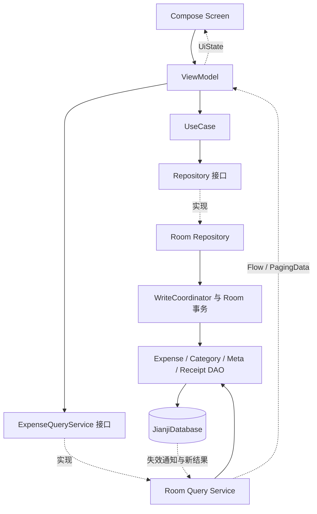
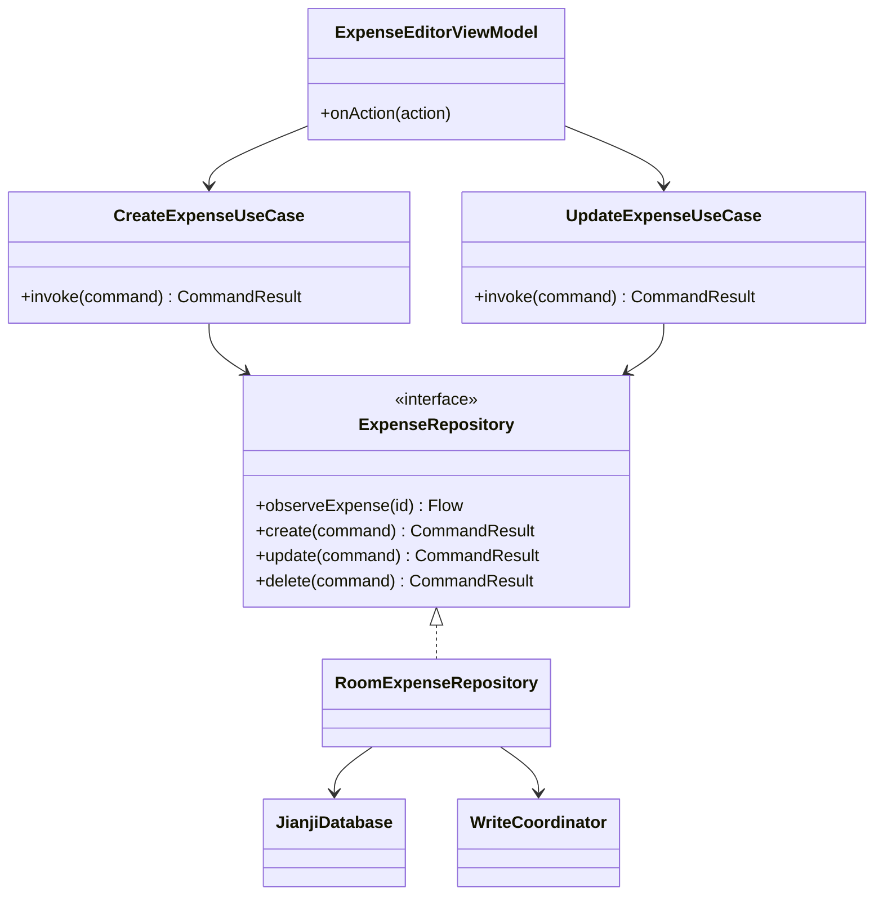
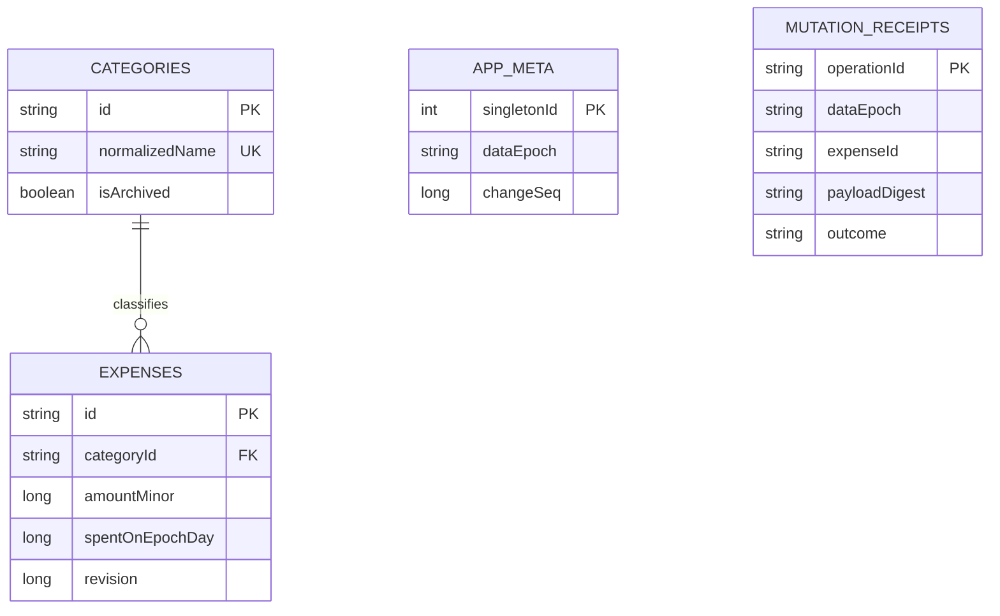
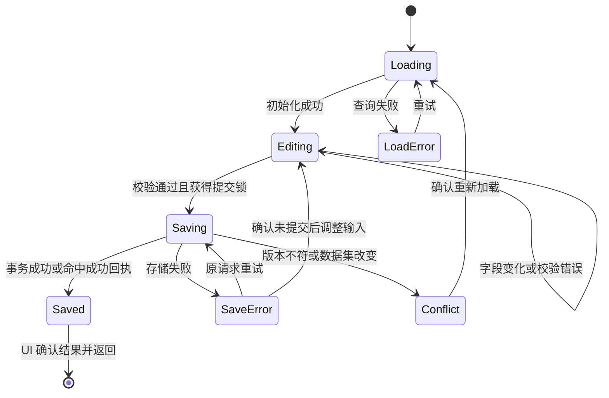
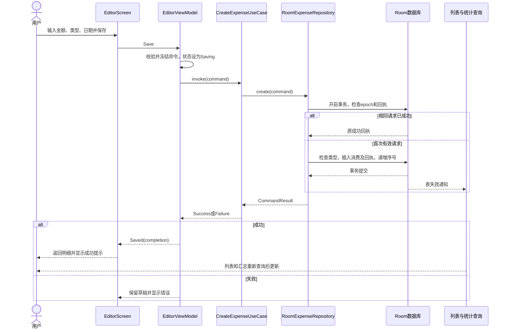
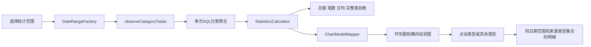
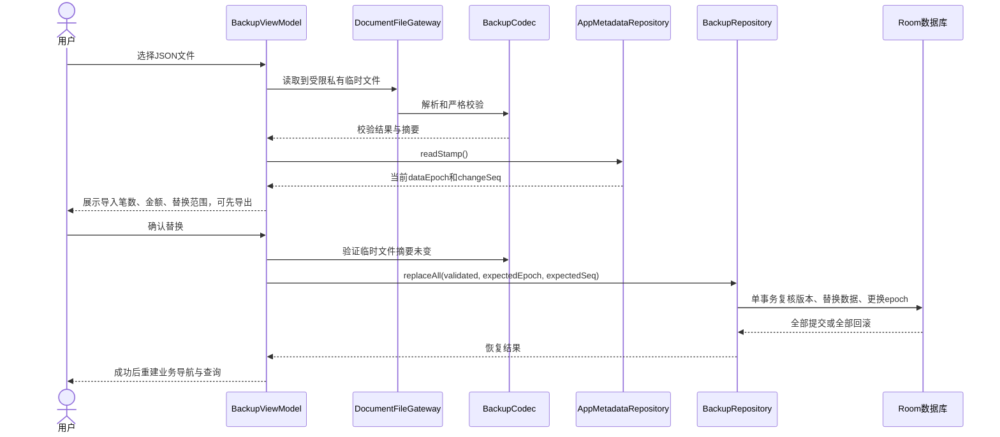

# 简记 Android App 详细设计

版本：v0.2 · 日期：2026-10-23 · 状态：P0 已编码；实现差异和验证见[实现与验证记录](实现与验证记录.md)

关联：[开发文档](开发文档.md) · [环境配置](开发环境配置.md) · [已完成的环境验证](环境验证记录.md)

## 1. 设计范围与使用方式

本文把产品规划细化为类职责、数据契约和处理流程。P0 覆盖添加、编辑、删除、历史查询、类型选择和分类统计；P1 进一步定义类型管理、预算和备份。P0 已按这些契约实现，部分小类合并以减少首版复杂度；本文接口片段仍用于说明设计，完整代码和实际类名以源码为准。类型管理和多图表已在 1.1.0 实现，落地规则和类职责见[1.1.0 更新说明](更新说明-1.1.0.md)。1.2.0 已实现 JSON 合并导入/导出和全部账单 CSV 导出，实际文件契约、限额、类职责与调用流程见[1.2.0 更新说明](更新说明-1.2.0.md)；本文第 9.3～9.4 节的全量替换恢复、预算和筛选 CSV 仍为后续设计。

首版是离线 App，“接口调用”指进程内 Kotlin 方法、Room DAO 和 Android 系统 API 调用，不需要搭建 HTTP 服务、登录接口或 Retrofit。未来云同步必须单独设计冲突、身份和隐私协议，不在本次接口中预留空的网络实现。

| 设计原则 | 对实现的约束 |
|---|---|
| 单一数据来源 | 数据库保存账单事实；统计由查询计算，不另存一份累计消费数值 |
| 职责分离 | Compose 显示状态；ViewModel 编排；UseCase 校验；Repository 事务写入；DAO 只访问数据库 |
| 明确调用结果 | 写入返回业务结果；可观察查询返回 Flow；分页错误使用 Paging 的 LoadState |
| 金额与时间一致 | 单笔金额使用整数分，日期使用 epochDay，审计时间使用 UTC epoch 毫秒 |
| 可重试且不覆盖新数据 | operationId 去重，revision 检测过期编辑，dataEpoch 阻止恢复前的旧命令 |
| 分阶段交付 | 先完成数据闭环，再做图表；P1 接口不等于 P0 要一次实现全部功能 |

## 2. 分层与功能类设计

### 2.1 依赖关系



业务模型位于 `domain/model`，不依赖 Context、Compose、Room 或 Paging。Repository 接口位于 `domain/repository`；分页查询接口单独放在 `application/query`，允许依赖 Paging 3，避免让金额、日期和写入校验依赖 Android 分页类型。实现类均位于 `data`。

### 2.2 启动和基础设施

| 类 / 组件 | 包 | 职责及主要入口 | 生命周期 |
|---|---|---|---|
| `JianjiApplication` | 根包 | 创建 AppContainer；不在主线程读库 | 进程 |
| `AppContainer` | `di` | 组装 Database、Repository、UseCase、Clock、DispatcherProvider | 进程；无 Activity 引用 |
| `JianjiDatabase` | `data/local` | 注册 Entity / DAO / Migration，执行 withTransaction | 单例，进程退出时由系统释放 |
| `BootstrapRepository` / `RoomBootstrapRepository` | `domain/repository` / `data/repository` | `initialize()`：打开数据库、初始化元数据与内置类型 | 进程内幂等 |
| `AppMetadataRepository` | `domain/repository` | `observeDataEpoch()` / `readStamp()`；提供当前数据集标识和变更序号 | 进程；读取 Room 元数据 |
| `AppViewModel` | `ui` | Loading → Ready / Error；只在 Ready 时开放业务导航 | 根导航图 |
| `AppNavHost` / `AppRoute` | `ui/navigation` | 明细、详情、编辑、统计、设置导航；恢复筛选状态 | Activity / BackStack |
| `WriteCoordinator` | `data/local` | 共享 Mutex 串行编排写入；最终约束仍由数据库事务保证 | 进程单例 |
| `TodayProvider` | `domain/time` | `currentDate()`、`observeDate()`；使用注入 Clock / ZoneId | 进程 |
| `DispatcherProvider` | `domain/common` | 注入 IO / Default，供文件处理和纯计算使用 | 进程 |
| `MoneyParser` / `MoneyFormatter` | `domain/money` | 输入文本转分值、分值格式化展示 | 无状态 |
| `DateRangeFactory` | `domain/time` | 构建当月、上月、全年、自定义日期开区间 | 无状态 |
| `ErrorMapper` | `data/error`、`ui/error` | 分别转换基础设施异常和用户提示资源 ID | 无状态 |

手动依赖注入即可。ViewModel 通过 Factory 获取依赖和 SavedStateHandle；不在 Composable 中 new Database / Repository。AppContainer 不持有消费列表缓存。

### 2.3 消费与统计功能类

| 功能 | 页面与 ViewModel | UseCase / 服务 | Repository / DAO |
|---|---|---|---|
| 新增消费 | `ExpenseEditorScreen` / `ExpenseEditorViewModel`（Create 模式） | `ValidateExpenseUseCase`、`CreateExpenseUseCase` | `ExpenseRepository.create` → `RoomExpenseRepository` → Expense / Category / Receipt / Meta DAO |
| 修改消费 | 同一编辑页（Edit 模式） | `ValidateExpenseUseCase`、`UpdateExpenseUseCase` | `observeExpense`、`update`；保留 originalRevision |
| 删除消费 | `ExpenseDetailScreen` / `ExpenseDetailViewModel` | `DeleteExpenseUseCase` | `delete`；确认后按预期 revision 删除 |
| 历史列表 | `ExpenseListScreen` / `ExpenseListViewModel` | `ExpenseQueryService`、`ExpenseFilterNormalizer` | `RoomExpenseQueryService` → ExpenseReadDao |
| 类型选择 | `CategoryPicker`，由编辑 ViewModel 提供状态 | `CategoryRepository.observeSelectable` | CategoryDao；编辑时包含原有停用类型 |
| 分类统计 | `StatisticsScreen` / `StatisticsViewModel` | `ObserveStatisticsUseCase`、`StatisticsCalculator` | `observeCategoryTotals` → ExpenseReadDao |
| 图表显示 | `CategoryDonutChart` / `CategoryBarChart` / `CategoryLegend` | `ChartModelMapper` | 只接收绘图模型，不自行查询数据库 |
| 统计钻取 | StatisticsViewModel → AppNavHost → 明细页 | 复用 `ExpenseFilter` | 同一个分页查询入口 |

`ExpenseEditorViewModel` 只负责编辑，不兼任列表、统计、类型管理。`StatisticsCalculator` 和 `ChartModelMapper` 是纯计算类，可使用普通 JUnit 验证。

核心写入类关系如下；箭头表示依赖，虚线三角表示实现接口：



### 2.4 设置及 P1 功能类

| 类 / 组件 | 主要职责 | 阶段 |
|---|---|---|
| `SettingsViewModel` / `SettingsRepository` / `DataStoreSettingsRepository` | observeTheme / setTheme；保存 SYSTEM、LIGHT、DARK | P0 |
| `CategoryManagementViewModel` / `SaveCategoryUseCase` / `ArchiveCategoryUseCase` | 名称规范化、唯一性、排序、停用；不级联删账单 | P1 |
| `BudgetViewModel` / `BudgetRepository` / `BudgetDao` / `ObserveBudgetUseCase` | 按 YearMonth 设置预算；观察预算与该月支出 | P1 |
| `BackupViewModel` / `ExportBackupUseCase` / `PreviewRestoreUseCase` / `CommitRestoreUseCase` | 导出、校验预览、确认恢复 | P1 |
| `BackupRepository` / `RoomBackupRepository` / `BackupCodec` | 一致性快照、流式 JSON 编解码、原子替换 | P1 |
| `DocumentFileGateway` | 封装 ContentResolver 的 Uri 流读写；domain 层不持有 Context | P1 |
| `CsvExportUseCase` / `CsvEncoder` | 完整筛选范围导出；RFC 4180 转义与公式前缀处理 | P1 |
| `UndoDeleteUseCase` / `UndoTokenStore` | 短时撤销；进程内 token、到期清理、恢复前冲突检查 | P1 |

## 3. 核心对象与持久化结构

### 3.1 领域模型

以下为契约示意。ID 使用 String 承载 UUID；生产实现通过工厂校验，不能把任意字符串当有效 ID。

```kotlin
data class Money(val minor: Long, val currency: String = "CNY")
data class DateRange(val startInclusive: Long, val endExclusive: Long)
sealed interface CategorySelection {
    data object All : CategorySelection
    data class Only(val ids: Set<String>) : CategorySelection
}
data class ExpenseFilter(
    val range: DateRange,
    val categories: CategorySelection = CategorySelection.All,
    val keyword: String = "",
)
data class Expense(
    val id: String,
    val amount: Money,
    val categoryId: String,
    val spentOnEpochDay: Long,
    val note: String,
    val createdAt: Long,
    val updatedAt: Long,
    val revision: Long,
)
data class WriteContext(val operationId: String, val dataEpoch: String)
data class ExpenseInput(
    val amount: Money,
    val categoryId: String,
    val spentOnEpochDay: Long,
    val note: String,
)
data class CreateExpenseCommand(
    val context: WriteContext, val expenseId: String, val input: ExpenseInput,
)
data class UpdateExpenseCommand(
    val context: WriteContext, val expenseId: String,
    val expectedRevision: Long, val input: ExpenseInput,
)
data class DeleteExpenseCommand(
    val context: WriteContext, val expenseId: String, val expectedRevision: Long,
)
```

约束：Money 用于消费输入时要求 `1..99_999_999` 分，汇总金额使用独立 Long 字段，不沿用单笔上限。DateRange 必须非空、起点不早于 1970-01-01、结束日不超过当前本地日期的次日。Only.ids 不能为空；空选统一规范化为 All，避免 `IN ()` 与“查不到任何类型”歧义。备注先 trim，再按 Unicode 码点计数；拒绝非法代理项、NUL，最多 200 码点。

`ExpenseDraft` 另保存金额原始文本、可空类型 ID、日期、备注、Create/Edit 模式和原始快照，便于展示字段错误和判断 dirty；数据库 Entity 不直接作为可修改表单状态。

### 3.2 展示与聚合模型

| 模型 | 关键字段 | 规则 |
|---|---|---|
| `ExpenseListItem` | expense、categoryName、iconKey、colorKey | JOIN 后的数据；类别改名后可重新查询 |
| `ExpenseSummary` | totalMinor、entryCount、dailyTotals: Map<epochDay, Long> | 覆盖整个筛选范围，不能只累加已加载分页 |
| `CategoryTotal` | categoryId、name、iconKey、colorKey、sortOrder、totalMinor、entryCount | SQL GROUP BY 输出，包含历史停用类型 |
| `StatisticsSnapshot` | range、totalMinor、entryCount、dayCount、averageMinor、allCategories | 由一次分类聚合结果计算，避免卡片与图表读取不同总额 |
| `ChartSlice` | key、label、amountMinor、ratio、sourceCategoryIds、colorKey | 聚合项保留其来源类型集合用于钻取 |
| `BarItem` | key、label、amountMinor、relativeLength、sourceCategoryIds | relativeLength 对最大金额归一化，仅用于绘制 |
| `FieldErrors` | amount、category、date、note 的可空错误码 | 错误码映射字符串资源；不存硬编码 Toast |

`averageMinor` 使用 BigDecimal 表示日均分值，展示时转换为元后 HALF_UP 保留两位小数；不向数据库写入舍入后的平均数。ratio 为高精度计算结果，Canvas 最后一步才转换为 Float。

### 3.3 表结构补充与关系

主表完整字段见开发文档第 4 节。P0 增加以下约束和辅助字段：

| 表 | 字段 / 约束 | 用途 |
|---|---|---|
| categories | normalizedName TEXT NOT NULL UNIQUE | 防止中英文大小写、全半角等规范化后的重名 |
| expenses | revision INTEGER NOT NULL，初值 1 | 更新时 +1，编辑/删除使用预期值比较 |
| app_meta | singletonId INTEGER PRIMARY KEY，固定 1 | 全数据库只有一行 |
| app_meta | dataEpoch TEXT NOT NULL | 新建数据库时生成 UUID；全量恢复时更换 |
| app_meta | changeSeq INTEGER NOT NULL，初值 0 | 每次真实账务写入 +1；P1 恢复预览用于发现新变化 |
| mutation_receipts | operationId TEXT PRIMARY KEY | 成功命令的唯一标识 |
| mutation_receipts | dataEpoch、operationType、expenseId、payloadDigest TEXT NOT NULL | 关联命令及参数指纹 |
| mutation_receipts | payloadEncodingVersion INTEGER NOT NULL，初值 1 | 回放时按原版本计算摘要，后续升级保留旧编码器 |
| mutation_receipts | outcome TEXT NOT NULL、resultRevision INTEGER NULL、committedAt INTEGER NOT NULL | 回放 Created / Updated / Deleted 结果；删除的 revision 为 null |

mutation_receipts.expenseId **不设置指向 expenses 的外键**：即使消费已删除，仍需保留回执防止旧新增请求重建它。P0 不按时间自动清理成功回执；若将来要裁剪，必须先定义幂等窗口及过期请求协议。回执中不保存完整备注和金额文本。

payloadDigest 使用 SHA-256，输入为固定字段顺序、UTF-8、明确编码版本的规范化序列：操作类型、数据集标识、消费 ID、预期版本（如有）、整数分、CNY、类型 ID、epochDay、trim 后备注。使用确定性编码器，不对随机字段顺序的 Map.toString 求摘要；执行时生成的 createdAt/updatedAt 不进入摘要。



`createdAt` 保持首次创建值；`updatedAt` 使用 Clock 的当前 UTC 毫秒，设备改时可能使它不单调，因此不能拿 updatedAt 替代 revision。P1 budgets 表以 `(monthKey, currencyCode)` 为联合主键，monthKey 为 `YYYY-MM`，另有 amountMinor、revision、createdAt、updatedAt；预算删除表示“未设置”，不以预算 0 元代替。

## 4. 接口契约与调用矩阵

### 4.1 统一写入结果

```kotlin
sealed interface CommandResult<out T> {
    data class Success<T>(val value: T, val replayed: Boolean = false) : CommandResult<T>
    data class Failure(val error: AppError) : CommandResult<Nothing>
}
enum class ExpenseOutcome { Created, Updated, Deleted }
data class ExpenseCommit(
    val operationId: String,
    val expenseId: String,
    val outcome: ExpenseOutcome,
    val resultRevision: Long?,
)
sealed interface AppError {
    data class Validation(val fields: FieldErrors) : AppError
    data object NotFound : AppError
    data object Conflict : AppError
    data object CategoryUnavailable : AppError
    data object IdempotencyConflict : AppError
    data object DatasetChanged : AppError
    data object StorageFull : AppError
    data object DatabaseBusy : AppError
    data object StorageFailure : AppError
    data object DataIntegrityFailure : AppError
    data object UnsupportedBackupVersion : AppError
    data object InvalidBackup : AppError
    data object FileAccessDenied : AppError
}
```

Success 仅在数据库提交后返回。replayed=true 表示同一命令以前已成功；它是对历史提交的确认，**不保证该消费现在仍存在或仍是当时版本**，页面必须观察当前数据，不能拿回执重建旧记录。可观察查询遇到 I/O/数据库异常时抛出分类后的异常，由 ViewModel 映射 Error 状态并提供重新订阅入口；不能用空列表吞掉异常。CancellationException 始终向上抛出，不映射成业务失败。

### 4.2 Repository 与查询服务

```kotlin
interface ExpenseRepository {
    fun observeExpense(id: String): Flow<Expense?>
    suspend fun create(command: CreateExpenseCommand): CommandResult<ExpenseCommit>
    suspend fun update(command: UpdateExpenseCommand): CommandResult<ExpenseCommit>
    suspend fun delete(command: DeleteExpenseCommand): CommandResult<ExpenseCommit>
}
interface ExpenseQueryService {
    fun pages(filter: ExpenseFilter): Flow<PagingData<ExpenseListItem>>
    fun observeSummary(filter: ExpenseFilter): Flow<ExpenseSummary>
    fun observeCategoryTotals(range: DateRange): Flow<List<CategoryTotal>>
}
interface CategoryRepository {
    fun observeSelectable(retainCategoryId: String? = null): Flow<List<Category>>
}
interface SettingsRepository {
    fun observeTheme(): Flow<ThemeMode>
    suspend fun setTheme(mode: ThemeMode): CommandResult<Unit>
}
data class DataStamp(val dataEpoch: String, val changeSeq: Long)
interface AppMetadataRepository {
    fun observeDataEpoch(): Flow<String>
    suspend fun readStamp(): DataStamp
}
```

retainCategoryId 只用于编辑保留原停用类型，不代表允许新建消费使用任意停用类型。Repository 在实际写入事务内再次检查类别状态，防止选择后被停用。主题存入 DataStore，与 Room 分开；主题成功不修改 app_meta.changeSeq，首版备份也不包含主题偏好。

UseCase 入口如下；operator invoke 与普通 execute 二选一，项目统一使用 invoke：

| UseCase | 输入 → 输出 | 内部调用 |
|---|---|---|
| `ValidateExpenseUseCase` | draft → 规范化 ExpenseInput 或 FieldErrors | MoneyParser、TodayProvider、字符串规则；不查库 |
| `CreateExpenseUseCase` | CreateExpenseCommand → CommandResult&lt;ExpenseCommit&gt; | 防御性静态校验 → ExpenseRepository.create |
| `UpdateExpenseUseCase` | UpdateExpenseCommand → 同上 | 防御性静态校验 → ExpenseRepository.update |
| `DeleteExpenseUseCase` | DeleteExpenseCommand → 同上 | ID / expectedRevision 校验 → ExpenseRepository.delete |
| `ObserveStatisticsUseCase` | DateRange → Flow&lt;StatisticsSnapshot&gt; | QueryService.observeCategoryTotals → StatisticsCalculator |

静态校验不包含“现在是否为未来日期”等随时间变化的条件；这些条件在事务确认不是回放请求之后重新检查。否则同一成功命令在时区改变后可能被错误拒绝，破坏幂等性。

### 4.3 DAO 操作及事务边界

| DAO 方法 | 数据库操作 | 返回及约束 |
|---|---|---|
| ExpenseDao.insert | INSERT ABORT | 主键碰撞返回业务冲突，禁止 REPLACE 覆盖旧记录 |
| ExpenseDao.findById | SELECT WHERE id | ExpenseEntity? |
| ExpenseDao.updateIfRevision | UPDATE WHERE id AND revision | 受影响行数；必须为 1，revision 同时 +1 |
| ExpenseDao.deleteIfRevision | DELETE WHERE id AND revision | 受影响行数；必须为 1 |
| ExpenseReadDao.pagingSource | 日期/类型/备注条件 JOIN categories | PagingSource&lt;Int, ExpenseListItem&gt; |
| ExpenseReadDao.observeDailyTotals | 同条件 GROUP BY spentOnEpochDay | Flow&lt;List&lt;DailyTotal&gt;&gt;；一份结果推导日小计、总额和笔数 |
| ExpenseReadDao.observeCategoryTotals | 日期条件 GROUP BY categoryId | Flow&lt;List&lt;CategoryTotal&gt;&gt; |
| CategoryDao.findById / observeSelectable | 主键查询 / 活跃类型和指定原类型 | 停用类型仍参与历史 JOIN 和统计 |
| MutationReceiptDao.find / insert | operationId 查询 / INSERT ABORT | 回执只存成功结果，与主表写入同事务 |
| MetaDao.read / incrementChangeSeq | 单行查询 / 序号递增 | 新事务读取，不使用过期内存快照 |

```sql
UPDATE expenses
SET amountMinor = :amountMinor, categoryId = :categoryId,
    spentOnEpochDay = :spentOnEpochDay, note = :note,
    updatedAt = :now, revision = revision + 1
WHERE id = :id AND revision = :expectedRevision;

DELETE FROM expenses WHERE id = :id AND revision = :expectedRevision;
```

Repository 使用 `database.withTransaction { ... }` 包住查回执、校验元数据、查目标/类型、写消费、写回执、递增序号。主键、外键和唯一索引由 SQLite 再次兜底。Mutex 不能替代 SQL 条件更新；今后新增后台任务也必须经过同一 Repository。

### 4.4 一次完整接口调用示例

```text
用户在新增页输入 12.30、选择餐饮、日期 2026-10-23
ExpenseEditorViewModel.onAction(Save)
  → ValidateExpenseUseCase(draft) = ExpenseInput(amount.minor=1230, currency=CNY, ...)
  → 构建 CreateExpenseCommand(context={operationId, dataEpoch}, expenseId, input)
  → CreateExpenseUseCase(command)
  → RoomExpenseRepository.create(command)
  → WriteCoordinator.withWriteLock { database.withTransaction { ... } }
  → ExpenseDao.insert + MutationReceiptDao.insert + MetaDao.incrementChangeSeq
  ← Success(ExpenseCommit(outcome=Created, resultRevision=1), replayed=false)
  → UiState 保存成功结果 → UI 确认消费后返回明细
  → Room 使列表 PagingSource 和聚合 Flow 失效并重查
```

日期值实际使用 epochDay，UUID 在运行时产生，不在文档中硬编码成业务常量。被动刷新不再调用一次“修改统计接口”。

## 5. 启动、导航与页面状态

### 5.1 启动流程

1. Application 组装 AppContainer；MainActivity 展示启动 Loading。
2. AppViewModel 调用 BootstrapRepository.initialize，在 Room 支持的挂起调用中打开库、执行 Migration。
3. 新数据库在事务中生成 app_meta 和 8 个固定 UUID 的内置类型。初始化标记使用数据库 schema / 元数据；后续启动不重置类型名称、停用状态或排序。幂等保护使用固定主键及 INSERT IGNORE，而非覆盖更新。
4. 读取初始 dataEpoch 与主题；主题读取失败使用 SYSTEM 并显示可重试提示，账务数据库初始化失败则停留错误页，禁止进入可保存状态。
5. 初始化成功进入明细页，默认范围为当月首日至今天（包含今天）。后续新增类别/修复种子必须通过显式迁移，不能每次启动盲目补回用户数据。

数据库损坏或迁移失败不得自动删库重建。初始化重试由用户触发，避免无限重试循环。

### 5.2 导航契约

| 路由 | 参数 | 返回规则 |
|---|---|---|
| ExpenseList | 可选规范化筛选；默认当月 | 底部主入口 |
| ExpenseDetail | expenseId | 删除成功或记录不存在时返回列表 |
| ExpenseCreate | 无旧记录 ID；内部生成 expenseId / draftId | 保存成功或放弃草稿后返回 |
| ExpenseEdit | expenseId | 首次读当前内容和 revision；保存后返回详情 |
| Statistics | 独立保存的范围选择 | 类型点击进入带筛选的 ExpenseList 实例 |
| Settings | 无 | 底部主入口 |

导航传 ID 和小型筛选对象，不传 Entity / 备注 / 完整账单 JSON。筛选使用类型化导航参数或 Navigation 支持的序列化 SavedStateHandle，禁止手工把备注拼接到 URL。类别 IDs 排序并去重后序列化。统计钻取列表是新 BackStack entry，不能覆盖主明细页已有筛选；返回时统计范围不变。

### 5.3 状态与事件



| 状态 | 关键字段 | UI 行为 |
|---|---|---|
| EditorUiState | draft、fieldErrors、originalRevision、isDirty、saveStatus、pendingCommand、completion | Saving 期间禁用保存及字段编辑；错误不清空草稿 |
| ListUiState | filter、summaryState、isRefreshing | PagingData 单独作为 Flow 暴露；LoadState 控制分页加载与重试 |
| DetailUiState | Loading / Content(expense, category) / Missing / Error、deleteStatus | 删除确认期间冻结 expectedRevision；并发变更要求重新确认 |
| StatisticsUiState | range、Loading / Content(snapshot, charts) / Empty / Error | 只展示与当前范围相符的结果 |
| SettingsUiState | theme、saveStatus | 保存失败恢复已持久化主题并提供重试 |

Compose 使用 `collectAsStateWithLifecycle` 订阅 StateFlow；列表使用 `collectAsLazyPagingItems`。ViewModel 以 `stateIn(viewModelScope, WhileSubscribed(5_000), initialState)` 共享普通查询，分页用 `cachedIn(viewModelScope)`。真实恢复仍从数据库重建状态，不能把共享缓存当持久化。

### 5.4 草稿、完成事件与进程恢复

- SavedStateHandle 保存原始草稿、expenseId、originalRevision、dataEpoch，以及当前不可变 pendingCommand 的必要标量。它覆盖系统重建场景，不承诺用户强制停止或清除任务后的永久草稿恢复；若需要长期草稿，另设计 drafts 表。
- operationId 在一次有效提交开始时生成；网络式“重试按钮”在这里实际是本地事务重试，复用原命令。修改输入表示新命令，必须产生新 operationId。
- 不用无 replay 的 SharedFlow 发送关键成功导航，防止页面停止收集时丢事件。成功结果放入状态中的 completion（带 operationId），页面恢复 STARTED 后通过 `LaunchedEffect(operationId)` 处理，成功返回后清除该编辑 BackStack entry。
- 如果进程在提交后、收到结果前消失，恢复时先用 pendingCommand 重试解析回执；命中回执只确认成功并返回，不自动再次写入。不能在结果未知时自动把同一草稿换新 operationId 重新提交。
- 通知 Snackbar 可以是非关键事件，但数据库成功与否以 CommandResult / 当前查询为准。对同一 operationId 的 UI 消费需幂等，导航前检查当前仍为对应编辑 entry。

## 6. 新增、修改、删除的执行逻辑

### 6.1 通用写入算法

所有消费写入复用以下处理顺序：

```text
UI 静态校验 → 构造不可变命令 → ViewModel 提交互斥
  → Repository / WriteCoordinator 加锁
  → 开启 Room 事务
      1. 读取 app_meta；dataEpoch 不一致返回 DatasetChanged
      2. 查 operationId 回执
         - 摘要一致：返回原成功结果，replayed=true，不写任何表
         - 摘要不同：返回 IdempotencyConflict
      3. 根据操作检查目标记录、expectedRevision 和类型状态
      4. 用当前 TodayProvider 再检查日期等动态约束
      5. 写消费；确认受影响行数
      6. 写成功回执；changeSeq +1
  → 提交事务后返回 Success → UI 处理完成结果
```

业务校验失败应在任何数据变更前返回 Failure。发生 SQL / I/O 异常时让事务回滚，再在事务外映射错误。禁止在事务中捕获数据库异常后直接返回 Success；禁止消费已写入但回执写入失败仍提交。首次新增若 expenseId 已被别的命令占用，返回 Conflict，而非把它视为当前请求成功。

### 6.2 新增时序



金额解析顺序：trim → 全角数字/小数点定向转换 → 匹配 `^[0-9]+(\.[0-9]{1,2})?$` → BigDecimal → `movePointRight(2).longValueExact()` → 范围检查。拒绝 `12.`、`.5`、`1e2`、`1,000`、`0`、`-1`、`0.001`；输入长度上限 32 个字符，防止不必要的大数解析。允许 `00012.30`，持久化为 1230 分。

### 6.3 修改流程

1. 按 expenseId 观察记录；初次加载将内容复制到 draft，并保存 originalRevision。找不到则进入 Missing。
2. 无 dirty 修改时可直接返回；存在 dirty 时，后续 Flow 更新不能覆盖用户输入，只提示“该记录有更新”。
3. 保存命令携带 expectedRevision。事务内比较 revision，不匹配返回 Conflict；用户选择重新加载或保留文本手动核对，不提供默认强制覆盖。
4. 校验类别：原 categoryId 若停用可保留；换到其他类型时必须选择活跃类型。若日期因设备时间调整变成未来，保存需用户修正日期。
5. 条件 UPDATE 修改业务字段和 updatedAt，保留 id / createdAt，revision +1。类型和日期在一次更新内更换，原月份/类别自然不再包含该记录。
6. 收到成功回执后返回详情；列表和统计观察数据库，不另外“减旧金额、加新金额”，避免重复累计。

### 6.4 删除流程

1. 详情页点击删除，生成含金额、类型、日期的确认模型并记住该版本。取消即结束，不调用 Repository。
2. 确认后生成 DeleteExpenseCommand；禁用重复确认；事务内检查 dataEpoch / 回执 / 当前记录。
3. 当前记录不存在且无该命令回执时返回 NotFound，提示“记录已不存在”并安全返回；不是静默回放成功。
4. 当前 revision 与确认时不同返回 Conflict；重新加载当前详情并要求再次确认，避免用户删掉已经改变的记录。
5. 条件 DELETE、写回执、递增 changeSeq 同事务提交。返回列表；若该筛选最后一条被删除，列表进入 Empty，统计总额为 0。

### 6.5 重复提交与竞争示例

| 情况 | 应有结果 |
|---|---|
| 保存按钮短时间点两次 | ViewModel 的提交锁只允许一次；数据库回执作为第二层保护 |
| 同一 operationId、完全相同参数重试 | 原成功结果，replayed=true，不改 revision / changeSeq |
| 同一 operationId、参数不同 | IdempotencyConflict，记录诊断码，不能覆盖回执 |
| 两个编辑入口都读取 revision=1 | 先提交者更新为 2；后提交者 Conflict |
| 新增后又删除，再收到旧新增请求 | 命中原新增回执，返回历史确认；不重新插入已删除消费 |
| 编辑页打开期间执行全量恢复（P1） | dataEpoch 改变，旧命令返回 DatasetChanged |
| 存储写满发生在回执写入时 | 整个事务回滚，消费也不能留下半条变更 |

## 7. 历史查询、筛选和分页流程

### 7.1 查询规范

1. 日期和类型变化立即更新筛选；备注关键词输入 debounce 300ms，再 trim 并 distinctUntilChanged。输入上限 200 码点。
2. ExpenseFilterNormalizer 验证日期、规范化类别集合和关键词，产生唯一筛选值；同一值用于列表、总额、笔数、日小计和 CSV 导出。
3. ViewModel 使用 `flatMapLatest` 切换查询，取消旧筛选订阅；每个筛选新建 Pager / PagingSource，不复用已失效实例。
4. `PagingConfig(pageSize=30, initialLoadSize=30, prefetchDistance=10, enablePlaceholders=false)`；每条使用 expenseId 作为稳定 key，日期头使用独立前缀 key。
5. 列表与汇总订阅同一筛选，数据库提交后自动失效刷新。两条独立 Flow 不保证每一帧来自同一快照：刷新时显示更新状态，稳定后结果必须一致。统计页面内部的总额、占比和图例则始终由同一次聚合快照推导。

基础查询示意；动态条件由绑定参数构造，绝不拼接用户文本：

```sql
SELECT e.*, c.name AS categoryName, c.iconKey, c.colorKey
FROM expenses e JOIN categories c ON e.categoryId = c.id
WHERE e.currencyCode = 'CNY'
  AND e.spentOnEpochDay >= :startInclusive
  AND e.spentOnEpochDay < :endExclusive
  AND (:keyword = '' OR instr(e.note, :keyword) > 0)
ORDER BY e.spentOnEpochDay DESC, e.createdAt DESC, e.id DESC;
```

Only 分支在相同 WHERE 中加 `e.categoryId IN (:categoryIds)`；All 分支不加此条件。使用两个明确 DAO 查询或受控参数化 QueryBuilder。`instr` 实现字面且区分大小写的子串匹配，`%`、`_`、引号都视为普通字符。P0 不支持模糊拼音或全文索引。

### 7.2 每日小计与分页边界

```sql
SELECT spentOnEpochDay, SUM(amountMinor) AS totalMinor, COUNT(*) AS entryCount
FROM expenses
WHERE currencyCode = 'CNY'
  AND spentOnEpochDay >= :startInclusive AND spentOnEpochDay < :endExclusive
  AND (:keyword = '' OR instr(note, :keyword) > 0)
GROUP BY spentOnEpochDay
ORDER BY spentOnEpochDay DESC;
```

Only 分支同样加类型条件，不能漏掉。完整 dailyTotals 的合计同时生成范围总额和笔数；某一天 50 条消费跨两页时，该日标题显示全部 50 条的合计，不能显示已加载 30 条的小计。PagingData.insertSeparators 按相邻记录日期插入日期头，处理跨页边界，避免每一页都重复显示同一天标题。

Entity / 类别更名均应触发 JOIN 查询失效；使用 RawQuery 时声明 observedEntities 包含 ExpenseEntity、CategoryEntity。金额汇总不必因纯颜色变化重新算，但 UI 图例必须更新。排序必须保留 id DESC 作为最后稳定排序键。

### 7.3 列表异常与日期切换

- refresh 失败且无已有内容：显示错误与重试；append 失败：保留已显示条目，在尾部提供 retry；不能清空为“没有记录”。
- 汇总失败时总额显示“暂不可用”，不能填 0；列表可继续展示。数据库刷新过程中不自动滚回顶部；用户明确切换筛选时滚到顶部。
- TodayProvider 在本地午夜、应用回到前台及日期/时区变化时重新求今天。跟随当月/全年模式更新结束日；手动自定义范围保留选择，但重新校验不能包含未来日期。
- 日期过滤与排序都依据业务日期 epochDay，改变设备时区不重写已有消费日期。

## 8. 消费统计、图表和钻取流程

### 8.1 数据处理管线



统计 SQL 沿用开发文档第 4.3 节，返回模型补充 sortOrder，并显式按金额降序、sortOrder 升序、categoryId 升序排序。停用类别不从历史聚合中剔除。类型名只是展示字段，不能作为分组标识。

### 8.2 计算步骤

1. 空列表生成 totalMinor=0、entryCount=0、Empty 状态；不进行比值和角度计算。
2. 用 Long 对分类总额和笔数求和，使用 `Math.addExact` 检查溢出；SQL SUM 溢出映射为 DataIntegrityFailure，不转换成 Double 继续显示。revision / changeSeq 递增也检查 Long 上界，溢出时拒绝写入并回滚，不能绕回负数。
3. dayCount = endExclusive - startInclusive，必须大于 0；日均以 BigDecimal(totalMinor) / dayCount 计算，展示到元的小数点后两位。分母不是“有消费的天数”。
4. 为每类计算 ratio = amountMinor / totalMinor，使用 BigDecimal 的明确精度（例如 DECIMAL128）；显示百分比 = ratio × 100，HALF_UP 保留一位小数。
5. 有消费的类别数 ≤ 8 时全部绘制；> 8 时保留前 7 类，其余汇总成独立 key `aggregate:remaining`，并保留所有 sourceCategoryIds。固定类型 UUID 不得与此 key 混用。
6. 完整文字表格仍使用 allCategories；聚合图形中各金额相加必须等于总额。类别稳定颜色按 colorKey 获取，聚合项使用固定中性色，不受列表位置影响。
7. 环形图从 -90° 开始，sweepAngle = ratio × 360；最后一段使用剩余角度闭合浮点误差，不修改原始金额与百分比。微小比例不人为扩大成假占比，可通过图例点击。
8. 柱形条 relativeLength = amountMinor / maxAmountMinor；最大值为 0 时显示空态。数值标签始终显示完整金额，不从像素长度反算金额。

角度、长度可以是 Float；金额、总额、排序与显示占比计算不使用 Float。多个百分比显示值相加可能不等于 100%，界面注明舍入误差，不随意修改最后一类显示比例。

### 8.3 点击与无障碍

- 图例和柱形条必须可点击，环形扇区点击是辅助方式。扇区命中测试先判断圆环内外半径，再按角度查对应区间；动画未结束时以当前绘制模型命中。
- 点击 ChartSlice / BarItem 产生 `OpenCategoryDetails(range, sourceCategoryIds)`，其中聚合项携带多类集合；明细 keyword 为空，与当前统计口径一致。
- 导航只使用当前 UiState 中展示的 snapshot.range，不能误取已经切换但尚未加载的新筛选。
- TalkBack 文案包含“餐饮，10 元，占 25%”；图例颜色不是唯一信息来源。文字表格始终可访问。

### 8.4 可复算示例

| 日期范围与数据 | 期望输出 |
|---|---|
| 2026-10-01～10-03，餐饮 10 元、交通 30 元 | 总额 4000 分，2 笔；日均 13.33 元；占比 25%/75%；环形角度 90°/270° |
| 修改交通为购物 20 元，日期不变 | 总额 3000 分；餐饮约 33.3%、购物约 66.7%；不再有交通扇区 |
| 删除购物 | 总额 1000 分；餐饮 100%；日均 3.33 元 |
| 再删除餐饮 | 总额 0、0 笔、空图表，不出现 NaN |
| 9 类各 1 元 | 完整表 9 行；图形 8 项，前 7 项各 1 元，“其余类型”2 元；钻取后恰好 2 条 |

## 9. 设置及 P1 扩展处理流程

### 9.1 主题与类型管理

主题：SettingsScreen → SettingsViewModel → SettingsRepository.setTheme → DataStore.edit；根 UI 观察主题 Flow。应用重启时恢复最近一次成功写入的值。DataStore 错误不能导致账单数据库重建。

类型管理的接口契约：

| 方法 | 输入 | 输出与规则 |
|---|---|---|
| CategoryRepository.observeAll | 无 | Flow&lt;CategoryCatalog&gt;，含类别列表及同一读快照中的 DataStamp，包含停用类型 |
| CategoryRepository.save | context、Create/Update 模式、id、name、iconKey、colorKey、expectedChangeSeq | CommandResult&lt;MutationCommit&gt;；创建 ID 必须不存在，更新 ID 必须存在，规范化重名拒绝 |
| CategoryRepository.archive | context、id、archived、expectedChangeSeq | CommandResult&lt;MutationCommit&gt;；不改变历史外键 |
| CategoryRepository.reorder | context、完整类别 ID 顺序、expectedChangeSeq | CommandResult&lt;MutationCommit&gt;；事务内一次写排序号 |

P1 将 mutation_receipts.expenseId 迁移为通用 entityId，并新增 entityType（EXPENSE / CATEGORY / CATEGORY_ORDER / BUDGET）及 resultChangeSeq，扩展 operationType / outcome；旧回执填充 EXPENSE，历史 resultChangeSeq 可为 null，保留摘要算法版本以支持旧命令回放。`MutationCommit` 包含 operationId、entityType、entityId、outcome、resultRevision（可空）和 resultChangeSeq（可空），不返回历史实体快照；页面通过 Flow 获取当前数据。CATEGORY_ORDER 的 entityId 固定为 `all-categories`；预算 entityId 固定为 `YYYY-MM:CNY`。

类型操作以 CategoryCatalog.stamp.changeSeq 检测较粗粒度的修改冲突，参数摘要也包含此预期值；实际数据改变时递增序号。重复设置已处于的停用状态、相同顺序或相同内容时写 NoChange 回执但不递增 changeSeq。所有类型采用停用/启用，界面不暴露硬删除；内置类型名和图标不允许编辑，自定义类型可改名。新建和改名都检查全部类型（含停用项）的 normalizedName 唯一性。

### 9.2 月度预算

`BudgetRepository.set(context, month, amount, expectedRevision?)` 创建/更新预算；新增 expectedRevision=null 且记录必须不存在，更新需版本一致。`remove(context, month, expectedRevision)` 恢复“未设置”。两者返回 CommandResult&lt;MutationCommit&gt;，复用事务回执协议；参数摘要包含月份和预期版本。金额输入复用 MoneyParser，预算上限暂与单笔上限相同，未来提高上限时使用独立规则。

首版预算月份限 1970-01 至当前本地月份，未来月份预算暂不开放。`observeBudgetSnapshot(month): Flow<BudgetSnapshot>` 从同一数据库快照读取该月预算和消费总额；可用观察 expenses/budgets/app_meta 的失效流触发 `withTransaction` 只读查询，避免独立 combine 时短暂配错数据。过去月份取整月，当月结束日截到今天的次日；未设置预算时 remaining / progress 为 null。

```text
remainingMinor = budgetMinor - spentMinor
isOverBudget = remainingMinor < 0
progressForDrawing = clamp(spentMinor / budgetMinor, 0, 1)
```

进度条可裁到 100%，文字超支金额不能裁剪。预算变化不改账单。更换月份时重新订阅，不把上月预算自动当成本月预算。

### 9.3 文件接口和导出

| 系统调用 | 发起层 | 返回处理 |
|---|---|---|
| `ActivityResultContracts.CreateDocument("application/json")` | BackupScreen | Uri?，null 代表取消，无错误 |
| `ActivityResultContracts.OpenDocument()` | BackupScreen，MIME application/json | 读取授权 Uri；不依赖真实文件路径 |
| `ContentResolver.openOutputStream(uri)` | DocumentFileGateway，IO 调度 | 通过 use 关闭；空流或权限失效映射文件错误 |
| `ContentResolver.openInputStream(uri)` | 同上 | 按字节限制读取，不一次无界 readText |
| CreateDocument("text/csv") | CSV 导出入口 | 按完整筛选导出，不是仅当前已加载页 |

Activity Result 注册在 UI，ViewModel 处理结果及任务状态。仅当前会话读写无需长期 Uri 授权；如果后续支持后台任务，需另设计可持久化授权和 WorkManager。取消文件选择不写回执、不改数据库。

备份接口：

```kotlin
interface BackupRepository {
    suspend fun captureSnapshot(): BackupSnapshot
    suspend fun replaceAll(
        validatedBackup: ValidatedBackup,
        expectedDataEpoch: String,
        expectedChangeSeq: Long,
    ): CommandResult<RestoreSummary>
}
// application 层持有 Uri；domain / 数据快照本身不依赖 Android Uri。
```

`captureSnapshot` 在短读事务中读取 categories、expenses、budgets 和 changeSeq 后结束事务，再写文件；不能一边遍历活库一边写可能阻塞的外部 Uri，造成备份前后不一致或长时间锁库。首版导出/恢复均限制 50MiB、100,000 笔消费、200 个类型、1,200 条预算，超限明确报错；在支持更大账本前先设计流式快照，不能无限增加内存。

JSON 包含 format=`jianji-backup`、schemaVersion、exportedAt、currencyCode、categories、expenses、budgets。业务 ID 和业务日期保持原值；不导出本地 dataEpoch、changeSeq、mutation_receipts、临时撤销 token、主题偏好或 pendingCommand。数据库 schemaVersion 与备份 schemaVersion 分别维护。

### 9.4 备份恢复的两阶段流程



校验必须覆盖：JSON 格式和版本、数量/大小、重复 ID、合法 UUID、币种、整数金额范围、日期范围、备注长度、类型外键、normalizedName 唯一性、内置类型固定 ID 集合、非负审计时间与合法 revision。只接受当前支持的备份版本；未知新版本拒绝，旧版本通过明确的转换器升级后再次校验。恢复日期规则与普通输入保持一致；因设备日期偏差导致未来日期的备份不得静默修改数据。

确认前把外部 Uri 内容复制到应用私有临时文件并记录 SHA-256，后续恢复使用同一份已校验内容，防止用户确认期间外部文件变化。临时文件只在本次恢复生命周期内有效，取消/完成后清理；进程死亡后要求重新选择文件和确认，不自动继续恢复。

恢复写入顺序：获得 WriteCoordinator → 事务复核 expectedDataEpoch 和 expectedChangeSeq → 删除 expenses / budgets / mutation_receipts → 删除 categories → 插入类别 → 插入消费和预算 → 生成新 dataEpoch，changeSeq +1 → 提交。外键保持启用，不使用 REPLACE 绕过约束。预览后账务有变化则返回 Conflict 并重新预览。

全量恢复成功时根 UI 观察 dataEpoch 改变，清除旧业务 BackStack、旧草稿和撤销 token，回到默认明细；旧命令即使迟到也因 epoch 不符被拒绝。写库期间取消导致未提交事务回滚；如果已提交但 UI 未收到结果，重新读取 dataEpoch / 数据展示实际状态，不盲目再次恢复。

CSV 文本字段先处理前导空白之后的 `= + - @`、Tab、CR、LF 等公式风险前缀，再按 RFC 4180 处理引号、逗号和换行；金额/日期按受控格式输出。写外部 Uri 失败可能留下部分文件，提示导出失败并允许重新选择目标，不宣称任意文档提供者都支持原子重命名。

### 9.5 删除撤销

P0 仅确认删除。P1 删除成功后可在进程内保存含原记录快照、dataEpoch 和单调时钟截止时间的 UndoToken，建议窗口 5 秒；过期、重启或恢复后不可撤销。快照不写日志。

撤销首次提交产生与删除不同的 operationId 并绑定 token，重复点击/重试复用该 ID。事务先检查 epoch 和回执，再对新请求检查 token 未过期、expenseId 尚未占用、原类型仍存在；恢复原 ID / createdAt / 消费日期，revision 使用删除前 revision +1。即使类型已停用仍允许恢复原引用。撤销也写成功回执并递增 changeSeq，重复点击不插入两次；回执回放不受之后 token 过期影响。任何冲突均告知用户，不能覆盖同 ID 的新数据。删除回执继续保留，迟到的原删除重试只回放旧成功结果，不再次删掉撤销后记录。

## 10. 错误处理、线程与一致性约定

### 10.1 错误到页面行为的映射

| 错误 / 场景 | 页面反馈 | 重试方式 |
|---|---|---|
| Validation | 对应字段显示规则，焦点定位第一项 | 修改输入后新提交 |
| CategoryUnavailable | 保留金额/备注，提示重选类型 | 新输入生成新命令 |
| NotFound | “记录已不存在”，关闭编辑或详情 | 返回明细，无自动重建 |
| Conflict | “记录已更新，请重新核对” | 重新加载版本，再创建新命令 |
| IdempotencyConflict | “提交状态异常，请重新打开页面” | 不静默换 ID；记录 operationId 与错误码 |
| DatasetChanged | “数据已恢复，请重新打开页面” | 清除旧页面，不提交旧草稿 |
| StorageFull | “存储空间不足”，保留草稿 | 清理空间后原命令重试 |
| DatabaseBusy | “数据正忙，请稍后重试” | 原命令重试；不无限自动重试 |
| StorageFailure / 数据库损坏 | 可读错误，保留输入；启动失败则阻止业务导航 | 用户重试或后续恢复入口，不自动清库 |
| DataIntegrityFailure | “数据无法安全处理”，不显示错误总额或继续写入 | 保留现状，定位溢出/非法数据，不以 0 掩盖错误 |
| 查询异常 | Error 或分页尾部错误，不显示假空态 | 重新订阅 Flow / Paging retry |
| FileAccessDenied / InvalidBackup / UnsupportedBackupVersion | 显示具体问题，不改本地数据 | 重新选择合法文件 |
| 协程取消 | 停止 UI 任务，关闭流与资源 | 结果未知时恢复后先解析同一 pendingCommand |

基础设施只映射已识别异常：SQLiteFullException → StorageFull，锁忙异常 → DatabaseBusy，文件授权 SecurityException → FileAccessDenied。约束异常结合操作上下文区分重复 ID / 类别引用 / 名称冲突；不能把所有 SQLiteConstraintException 都显示成“金额错误”。未知编程异常在开发构建中保留堆栈供定位，生产中显示通用错误且不记录财务正文。

### 10.2 线程与资源管理

- ViewModel 在 viewModelScope 发起任务；Room suspend / Flow 使用其查询与事务执行器，不调用 allowMainThreadQueries。
- 文件读写和备份编解码使用注入 IO / Default；图表模型计算可放 Default，Compose Draw 阶段只负责绘制。
- 不跨外部文件选择、用户确认、Snackbar 或导航持有事务/Mutex；对外写文件前已结束读取数据库的事务。
- 所有流通过 use 关闭；错误页重试重新创建失效查询，避免对已经终止的 StateFlow 上游仅设置 Loading。
- 记录诊断时允许 operationId、操作类型、耗时和错误码；禁止完整备注、全部备份内容或签名密钥。

### 10.3 不变量清单

1. 同一成功 operationId 对账务最多产生一次实际变更；回放不递增 changeSeq。
2. 每条消费引用存在的类型；类别停用不破坏历史 JOIN。
3. 编辑成功只修改一行，并使 revision 恰好 +1。
4. 统计总额 = 完整类别金额之和 = 同范围完整明细金额之和；分页加载多少不改变汇总。
5. 图表聚合项金额之和等于总额，sourceCategoryIds 覆盖且不重复。
6. 任一失败的事务不得留下消费/回执/元数据中的部分更新。
7. 恢复成功才更换 dataEpoch；旧数据集命令不能写入新数据集。

## 11. 编码顺序与测试映射

### 11.1 建议实现顺序

| 顺序 | 具体产物 | 可以验收的结果 |
|---|---|---|
| 1 | MoneyParser、DateRangeFactory、ExpenseFilterNormalizer、错误与命令模型 | 输入、日期及规范化的纯单元测试 |
| 2 | Entity / DAO / Database、种子初始化、schema 导出 | 内置类型、外键、索引和初始化幂等验证 |
| 3 | RoomExpenseRepository、WriteCoordinator、回执、revision | 新增→编辑→删除及重复提交闭环 |
| 4 | Editor / Detail ViewModel、导航和草稿状态 | UI 可完成记账闭环，恢复不重复写入 |
| 5 | ExpenseQueryService、Paging、完整汇总 | 历史筛选、跨页日小计与错误重试 |
| 6 | StatisticsCalculator、ChartModelMapper、统计页 | 正确占比、空态、Top-N 及点击钻取 |
| 7 | 主题、访问性、设备测试 | P0 全体验验收 |
| 8 | 类型管理→预算→备份与恢复→撤销 | 分别加入 P1 接口、迁移和边界测试 |

新增表首次随业务数据库 schema v1 建立；当前骨架尚无 Room 数据，因此不存在需要迁移的旧账本。后续任何已发布 schema 的修改均补迁移测试，不借“开发版本”名义直接清除真实用户数据。

### 11.2 类与测试用例对应

| 测试对象 | 类型 | 必测场景 | 对应产品验收 |
|---|---|---|---|
| MoneyParser / ValidateExpenseUseCase | JUnit | 0、边界上限、三位小数、全角、指数、超长文本、码点长度 | A04 |
| DateRangeFactory / TodayProvider | JUnit | 月末、跨年、闰日、本地午夜、时区变化、自然日分母 | A06、A09 |
| BootstrapRepository / Migration | Room 仪器测试 | 首次种子、重复启动不覆盖设置、迁移保留账单 | A13 |
| RoomExpenseRepository | Room 仪器测试 | CRUD、外键、条件更新、失效通知 | A01～A03 |
| 回执与事务 | Room 仪器测试，注入失败点 | 同命令重试、不同摘要、回执写入失败回滚、删除后旧新增重放 | A05 的增强 |
| revision / dataEpoch | Repository + ViewModel | 双编辑竞争、确认删除后记录被修改、恢复后旧命令 | A02、A03、A14 的增强 |
| ExpenseQueryService | Room + Paging 测试 | 50 条同一天跨页、字面 `%_`、多类型、类别更名、append 失败 | A06 |
| StatisticsCalculator / ChartModelMapper | JUnit | 10/30 元示例、单类型、0、9 类、舍入误差、聚合源集合 | A07～A10 |
| EditorViewModel / 导航 | 协程测试 + Compose / 设备测试 | 重复点击、取消、旋转、停止收集后完成事件、系统重建后重试 | A05、A11 |
| BackupCodec / RoomBackupRepository | JUnit + Room | 损坏/新版本/超限/重复 ID/断引用、预览后变化、替换中断、往返一致 | A14 |
| 图表与页面 | Compose + 真机/模拟器 | 大字体、TalkBack、深色、48dp 触控、API 26/35 | A12 |

协程单元测试使用虚拟调度器和固定 Clock，避免 sleep 等待；数据库行为使用实际 Room 测试库，不用只验证 mock 被调用来代替事务测试。关键失败点包括主表写入后、回执插入前、恢复删除旧数据后，均需验证完整回滚。

本文此次交付只更新文档。以上业务测试均为后续开发要求，不应在环境验证记录中标记为已通过。
